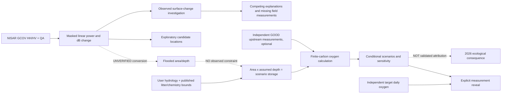

# NISAR essentiality audit — initial dependency result

1. Actual NISAR power supplies six HH/HV terrain layers, local acquisition values, three-epoch changes, derived contrasts, quality/looks checks and the original radar-tail candidate set. Earlier surface-water ranking experiments also used actual NISAR predictors; their positive claim remains withdrawn/inconclusive.
2. In the finite-carbon oxygen experiment NISAR supplies landscape context and a display anchor, not an observed flooded volume or a quantitative oxygen input.
3. No litter, carbon-yield, decay, area, depth, exchange, river flow, volume or connectivity bound is constrained by NISAR. The optional upstream temperature/oxygen values depend on the chosen timestamp, so changing the date can change those inputs. That is an indexing effect, not an inference from backscatter.
4. Removing NISAR removes the L-band observables and original candidate-selection information. With geography, timestamps, independent boundary values, scenario parameters and random draws held fixed, the current oxygen solver has no numerical NISAR dependency. A controlled ablation will verify this rather than change those assumptions.
5. There is no demonstrated narrowing of flooded-area/depth, hydraulic connectivity, carbon loading or oxygen uncertainty due to NISAR.
6. HH/HV L-band measurements are additional observables beyond the retained Sentinel-1 VV/VH and optical labels. Different wavelength, polarization, geometry and acquisition times prevent attributing disagreement to wavelength alone. No independently validated inundation information missed by conventional sensors has been established.
7. The implemented contribution is a transparent evidence/dependency investigation with an explicit sensor-removal experiment, hypothesis limitations, finite carbon budgets, hidden-outcome reveal and measurement requirements. It does not invent DODOC/BRAT, claim a new physical mechanism or establish algorithmic uniqueness over all existing tools.

## Dependency map

Unsupported links are radar-to-inundated area/depth, candidate-to-sensor hydraulic connectivity, antecedent carbon exposure, and modeled depletion-to-real ecological outcomes. A common scene/reference shift prevents identifying instrumental and environmental components. The 40 MHz warning and polarimetric phase adjustment do not justify correcting the present 20 MHz diagonal powers. Refer to the retained native audit and official provisional limitations.

## Frozen ablation specification

A = retained field/water-quality observations. B = A plus Landsat and Sentinel-1/Sentinel-2 context. C = B plus NISAR. Use the same 26 retained locations, same selected observation schedule, same optional upstream matches and the same default 512-member configuration, seed and model equations. No fitting, threshold search or new water-label benchmark. The same anchors are retained even when NISAR is hidden. The candidate set was originally selected using radar tails and includes six monitoring contexts: it is not a sensor-blind population or a valid design for estimating mapping/placement advantage.

For each arm, independently rerun the current solver and compare exact canonical hashes and absolute differences in demand, oxygen paths/minima, bounds, sensitivity and numerical diagnostics. List the added sensor observables separately. Do not interpret identical model outputs as evidence that NISAR can never help; it demonstrates no current implemented physical constraint. Do not interpret changed evidence visibility or rule-based survey suggestions as an independently validated environmental decision benefit.

## Executed ablation result

All three arms independently ran the same 512-member solver. The complete canonical JSON output hashes match exactly: `ad300174cb4b006e6e732eb511bd4ffb605f5e6a0a3bf34a6d6c09fecc671474`. Maximum absolute numeric output difference is **0** in B versus A and C versus A, including all trajectories, demand, sensitivity, bounds and numerical diagnostics. Median potential demand remains 127.881 tonnes O2; median minimum river oxygen remains 8.965226 mg/L. These are conditional simulations, not measured environmental outcomes. No NISAR-associated reduction of model uncertainty is demonstrated.

| Arm | Actual evidence added | Quantitative oxygen-input change | Environmental conclusion |
|---|---|---|---|
| A | Field/water-quality records | Baseline assumptions and eligible upstream boundary data | No event attribution |
| B | A plus Landsat exposed-water labels and Sentinel observations | None in the present solver | Cross-date surface context; no canopy inundation truth |
| C | B plus actual NISAR HH/HV and reference behavior | None | Additional measured L-band scattering change; cause and flood conversion unresolved |

The physical output does not change because no validated link from backscatter to inundation exposure/storage or carbon loading exists in this implementation. **This is an absence of an implemented/supported constraint, not evidence that L-band radar can never improve water-quality investigations.** Changing a user-assumed flooded area and calling the change a NISAR benefit would be invalid. Changing date, geography or upstream values across arms would also confound this experiment.

The new live arm toggle exposes this result. It changes measurement visibility while preserving the currently calculated scenario and its physical-output SHA-256. Frozen default-arm numbers are labeled separately from edited live assumptions. Readily leachable litter and river dilution still control different simulated outputs; adding a sensor name does not alter those distributions.

## What NISAR does add

For the fixed default block candidate-2, August-to-September measured HH change is +3.670124 dB, HV change +0.066123 dB, and the change in HH-minus-HV contrast is +3.604001 dB. The regional HH median changes -1.481926 dB. These are additional L-band observables and a location-specific physical question, not inundated area or dissolved oxygen. The HH-minus-HV contrast is a log-power ratio change; it is not a decomposition or a validated flooding index.

Assuming the built-up or bare/sparse proxy medians as common offsets gives local HH residuals of +4.471026 / +4.753417 dB. They are two sensitivity calculations, **not** calibrated confidence bounds or an applied correction. References may physically change and artifacts may vary spatially. Local native neighborhoods and matched-grid references also have slightly different support. NISAR can motivate checking heterogeneous surface change and common radiometry; it cannot distinguish flooded vegetation, soil moisture, roughness, vegetation change or instrumental effects by itself here.

The new dossier contains four transparent questions: whether a repeat radar change is measured; what clear exposed-water labels show; whether a common scene shift could contribute; and whether a hydraulic connection to the river sensor is established. Status text reports evidence availability and missing discriminating observations. There are no fitted plausibility scores, causal probabilities or new favorable classification tests.

The new dossier filters field visits and conventional/NISAR observations by exact recorded UTC timestamps at/before the selected original anchor. Sentinel-2 times match the platform actually used in the retained mosaics. Historical delivery times remain unverified. Existing historical methods and full archives are still available; no forecast is implied. The main flood-evidence cards use reference dates through the anchor, and the same retrospective/cutoff rules apply in B/C.

## What should be measured next?

For surface interpretation, the app identifies the selected existing 100 m block (coordinates supplied by the retained data), asks for archived dated water/depth/canopy observations matched to the study interval, and recommends paired water/soil/vegetation observations during a future repeat. A future visit cannot establish the historical event state. For calibration, it requests actual invariant targets/acquisition QA rather than declaring built/bare proxies stable. For oxygen, it requests actual outlet routing, discharge, DOC bioavailability and subdaily upstream/downstream oxygen. Current model sensitivity is shown only after calculation and is cleared when inputs change.

These are transparent evidence requirements and conditional model priorities, not mathematically optimal sensor locations or validated management decisions. Adding NISAR changes the available scattering/calibration question at the fixed site. No independently measured improvement in a survey outcome or environmental decision has been demonstrated.

## Model audit and prior art

The finite-carbon equations and published ranges are unchanged. Additional audit checks all 512 base members in each retained default/disconnected/low-flow scenario at the saved time step and half-step. Maximum minimum-river oxygen differences are 0.000119892, 0.000002257 and 0.004926858 mg/L, respectively, below the declared 0.005 mg/L diagnostic. Oxygen/carbon ledgers remain closed numerically, and the fixed-volume boundary flows satisfy water continuity. This checks base-ensemble minimum-river oxygen, not every trajectory/output or every sensitivity hybrid.

Stoichiometry is 32/12 kg O2 per kg oxidized C; finite litter pools and oxygen-limited reaction prevent unlimited oxygen consumption. Volumes, flow, connectivity and initial conditions remain explicit assumptions. Temperature relationships and ranges remain traced to Gibbs, Wallace & Mosley (2022), Table 1, and pinned DODOC formulas. Sensitivity indices and their bootstrap intervals remain conditional on independent uniform inputs and the simplified model. Mass balance is necessary software/physics consistency, not evidence those assumptions describe the event.

DODOC/BRAT already represent floodplain litter, DOC/oxygen processes and, in DODOC, hydrological routing. Oxygen Debt's contribution is its sensor-dependency audit, evidence-to-hypothesis interface, conservative teaching budget and transparent measurement reveal/requirements. We neither claim invention of blackwater modeling nor reproduce published calibrated model skill. See [docs/FLOOD_EXPERIMENT.md](FLOOD_EXPERIMENT.md) for structural omissions, units and exact parameter sources.

## Reproduce and interpret

Run `python scripts/run_ablation.py` and `python scripts/audit_model.py` from the public repository after installing dependencies. No raw radar files or network are needed for these snapshot-based experiments. Complete results are in [data/derived/nisar_ablation.json](../data/derived/nisar_ablation.json) and model_audit_03.json. The protocol record explicitly distinguishes the initial pre-execution audit document from the later machine-readable record; this is not an external preregistration. No search for a positive test was performed.

## Additional matched-boundary dependency control

After the primary ablation, a secondary software-dependency check was specified: hold the first retained Pike epoch with aligned GOOD upstream oxygen/temperature fixed across A/B/C. The block and original August anchor stay fixed; actual upstream records supply only constant temperature/oxygen boundaries. This check does not establish hydraulic connectivity or an event-specific fit. Its configuration, source timestamps, grades and independent rerun results are recorded under matched_upstream_control in the ablation JSON. It is explicitly an additional check, not an external preregistration or a search for improved sensor skill.

The matched-boundary control also returns zero numeric difference and matching hashes across A/B/C. Its actual GOOD upstream concentration/temperature are 10.743177 mg/L and 14.290382 C, respectively, used as constant scenario boundaries at the fixed August anchor. Its median minimum-river oxygen is about 10.684543 mg/L; this is another conditional simulation, not a target prediction.

Fingerprints use sorted canonical JSON with numeric type normalization: mathematically equivalent integral/float inputs such as 100 and 100.0 share a fingerprint. Unequal floating-point values are not rounded. Boolean/string types remain distinct. All primary numeric output differences were independently checked as exactly zero. The fingerprint normalization was corrected during software verification so live API float inputs and dataclass defaults can be compared without serialization-only differences.

Water-boundary interpretation: Qr is background channel flow entering the receiving box in addition to the independent floodplain supply Qf. If applying an upstream gauge that already includes a wetland diversion, the diversion would have to be accounted for before assigning Qr; the model does not route that operation or infer it from NISAR. Current flow values remain assumed. Continuity of the stated boundary network does not establish that this network describes the real site.
